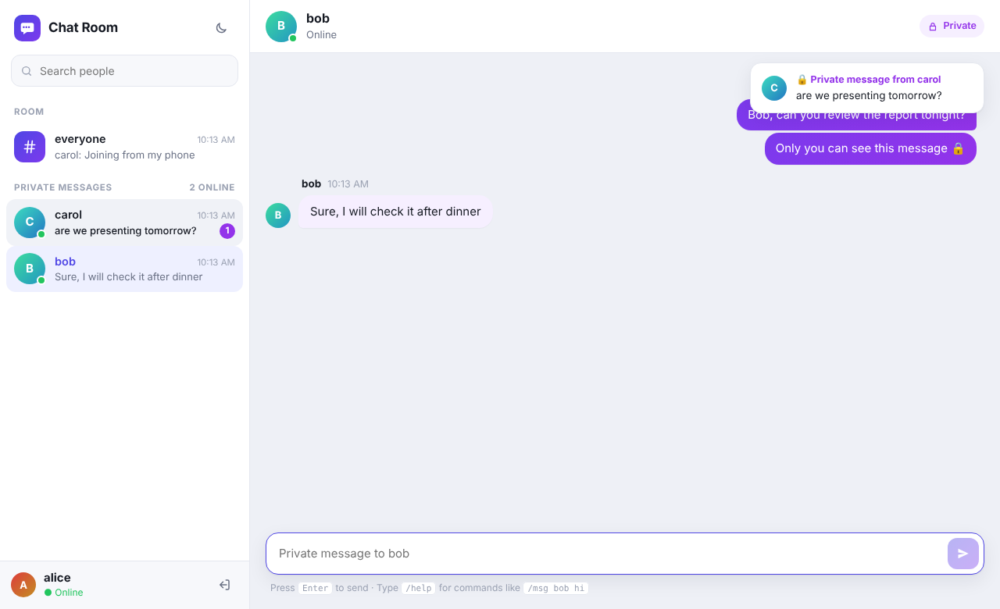
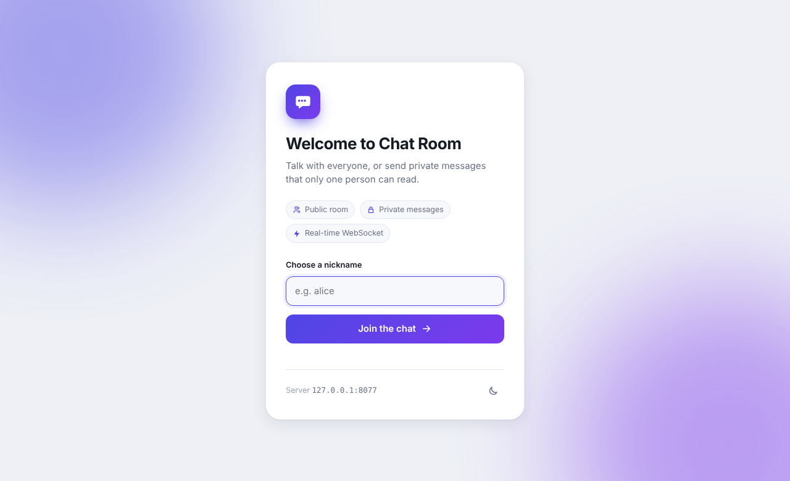
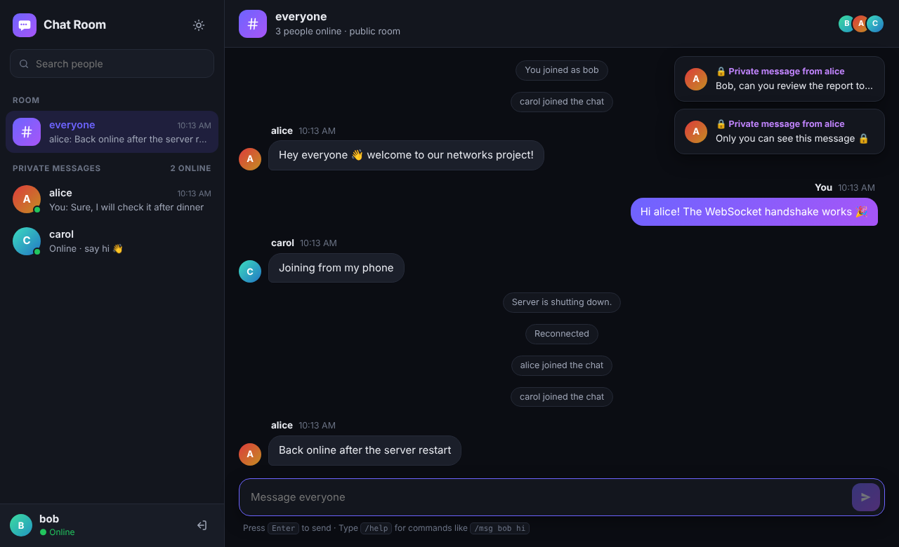
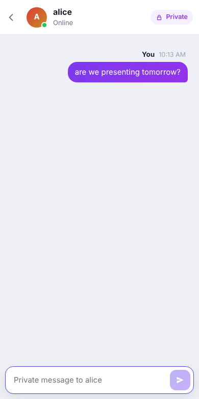

# Chat-Room

A multi-client TCP chat room in Python (standard library only) with **public and private messages**, a terminal client, a Tkinter GUI client and a **website** (WebSocket written from scratch). Everyone shares the same room, so people in the browser, the terminal and the GUI can all send each other private messages.

## Two laptops with the website

1. Connect both laptops to the same Wi-Fi.
2. On laptop A, run `python -m chat.server`. It prints a line like `Website: open http://192.168.0.39:8000 ...`.
3. Open that address in a browser on **both** laptops (or on a phone) and join with different nicknames.
4. Click a name in the user list to send that person a private message.

Laptop B only needs a browser, not Python. If it can't load the page, allow Python through Windows Firewall on laptop A (TCP port 8000).



| Join screen | Dark mode | Phone |
|---|---|---|
|  |  |  |

**Website features:** a public `#everyone` room plus a separate private conversation with each person, online indicators, unread badges, pop-up notifications for new private messages, people search, light/dark mode, a phone layout, and automatic reconnection if the server restarts. The terminal commands (`/msg`, `@user`, `/r`, `/users`, `/help`) also work in the message box.

## Deploy it on the internet

The project has no dependencies, so it runs as-is on any platform that can run Python or Docker. The server serves the website on the port in the `PORT` environment variable that hosting platforms set. Browsers then use `https://` and `wss://` automatically.

### Render (free)
1. Push this repository to GitHub, then sign in at [render.com](https://render.com) with GitHub.
2. Click **New → Blueprint** and pick this repository. Render reads `render.yaml` and creates the service.
   Alternatively, click **New → Web Service** and set *Build command* `pip install -r requirements.txt` and *Start command* `python -m chat.server`.
3. When the deploy finishes, open the `https://chat-room-xxxx.onrender.com` link on any two devices, anywhere in the world.

On the free plan the service sleeps after about 15 minutes without visitors, and the first visit then takes around 30 seconds to wake it up.

### Railway / Heroku
These platforms detect Python from `requirements.txt` and start the app with the `Procfile` (`web: python -m chat.server`). No settings are needed.

### Docker (any VPS or cloud)
```bash
docker build -t chat-room .
```
```bash
docker run -p 8000:8000 -p 5000:5000 chat-room
```
Then open `http://<server-ip>:8000`.

> On hosting platforms only the website port is public, so the terminal and GUI clients (raw TCP port 5000) work only on your LAN or on a VPS where you open that port.

## Running

Requires Python 3.10+.

```bash
python -m chat.server      # TCP clients on port 5000, website on port 8000; prints the LAN IP to share
```

```bash
python -m chat.client --port 5000 --name alice     # terminal client
```

```bash
python -m chat.gui_client --port 5000              # GUI client (needs tkinter)
```

To connect from another computer on the same network, pass the server's IP: `python -m chat.client --host 192.168.x.x --name bob`. If that fails, allow TCP port 5000 through the firewall.

To see the whole thing in a single terminal, which is handy for a presentation:

```bash
python demo.py
```

The full project report (networking concepts, protocol, diagrams, test results, viva questions) is in [`docs/REPORT.md`](docs/REPORT.md).

## Sending private messages

| Command | Description |
| --- | --- |
| `/msg <user> <message>` | Private message (aliases `/w`, `/pm`, `/whisper`, `/tell`) |
| `@<user> <message>` | Shortcut for a private message |
| `/r <message>` | Reply to the last person who sent you a private message |
| `/users` | List connected users (alias `/who`) |
| `/help` | Show the command list |
| `/quit` | Leave the chat |

Anything else is sent to everyone. Nicknames are case-insensitive when you address someone (`/msg BOB hi` reaches `bob`). Only the recipient gets a private message, and the sender gets a copy as confirmation (`[PM to bob] ...`). Unknown users, and sending a message to yourself, return an error.

**GUI:** the list on the right shows who is online. Select **Everyone** for public chat, or select a user so that what you type goes to them privately (double-click a user to jump to the input box). Private messages are shown in purple. All the text commands above also work in the GUI input box.

## Protocol

Newline-delimited JSON over TCP. The message types are documented in `chat/protocol.py`.

## Tests

```bash
python -m unittest -v
```
