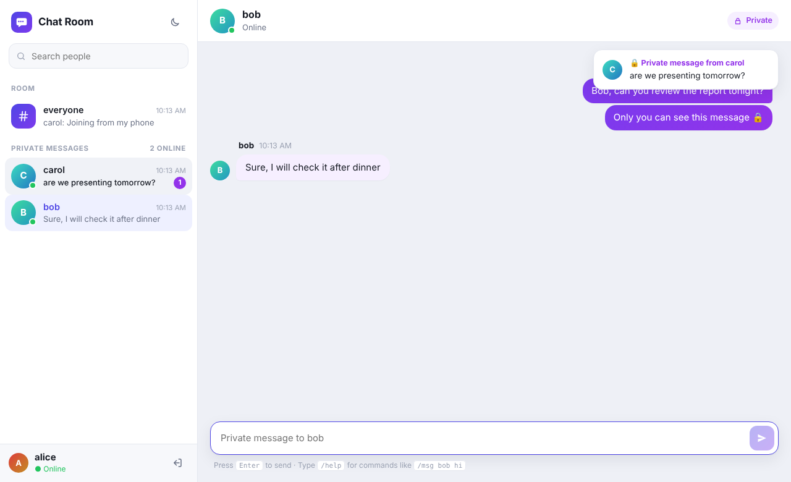
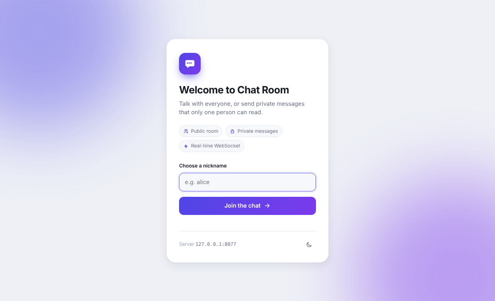
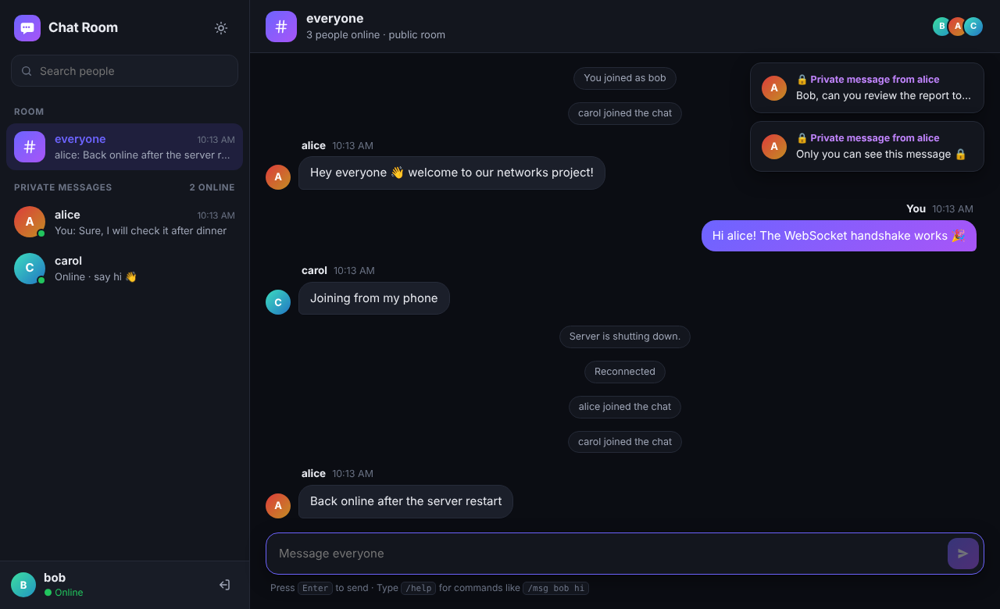
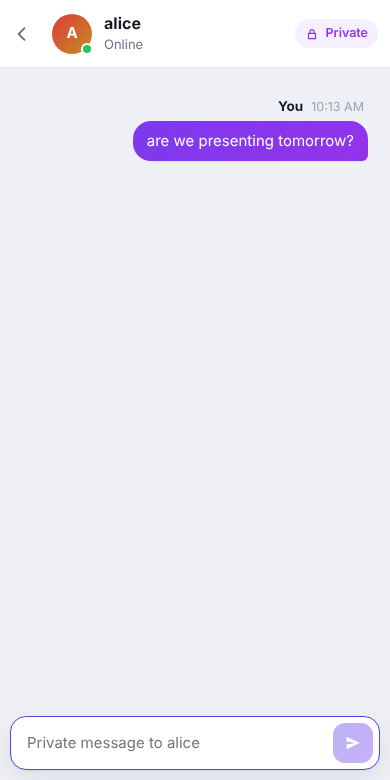

# Mini Project Report: Chat Room with Private Messages

**Subject:** Computer Networks
**Language:** Python 3.10+ (standard library only: `socket`, `socketserver`, `http.server`, `threading`, `json`, `hashlib`, `tkinter`) + HTML/CSS/JavaScript for the website

---

## 1. Abstract

This project is a client–server chat application that runs over **TCP/IP sockets**. Many clients connect to one central server. Each client can send **public messages**, which the server delivers to every connected user, and **private messages**, which the server delivers only to the named recipient. Users can send private messages with text commands (`/msg`, `@user`, `/r`) in a terminal client, by selecting a user in a Tkinter GUI client, or from a **website** that any laptop or phone on the network can open in a browser. The website talks to the server over **WebSocket**, which we implement from scratch (HTTP upgrade handshake + frame encoding). Browser users and terminal/GUI users share one chat room, so they can message each other. The project covers the main concepts of the transport and application layers: sockets, ports, connection-oriented communication, concurrent servers, message framing and application-layer protocol design.

## 2. Objectives

1. Build a TCP server that accepts and serves many clients at the same time.
2. Design an application-layer protocol for chat messages.
3. Support **public (broadcast)** and **private (unicast)** messaging.
4. Provide a command interface (CLI) and a graphical interface (GUI) for sending private messages.
5. Handle errors: unknown users, duplicate nicknames, malformed data and abrupt disconnects.
6. Allow communication between different computers on the same LAN.
7. Provide a website so a second laptop needs only a browser, by implementing the WebSocket protocol (RFC 6455) on top of TCP.

## 3. Networking concepts used

### 3.1 Client–server architecture
The server has a fixed, known address (IP + port, default port `5000`). Clients start the connection, and the server never contacts a client first. All messages go **through the server**: clients never talk to each other directly. This lets the server enforce privacy, because only the server decides who receives each message.

```
          +-----------+
 alice -->|           |--> alice
 bob   -->|  SERVER   |--> bob        (every message passes through the server,
 carol -->| port 5000 |--> carol       which decides who receives it)
          +-----------+
```

### 3.2 TCP vs UDP — why TCP?
| Requirement | TCP | UDP |
|---|---|---|
| Messages must not be lost | ✔ retransmission | ✘ |
| Messages must arrive in order | ✔ sequence numbers | ✘ |
| Need to know who is connected | ✔ connection state | ✘ connectionless |

Chat messages must arrive complete and in order, so we use **TCP** (`socket.SOCK_STREAM`). TCP sets up a connection with the **three-way handshake** (SYN → SYN-ACK → ACK) when `socket.create_connection()` is called. The handshake is done by the operating system, below our code.

### 3.3 Sockets and ports
A socket is an endpoint identified by **(IP address, port)**. A TCP connection is identified by the 4-tuple
`(client IP, client port, server IP, server port)`. Every client connects to the same server port `5000`, but the OS gives each client a different *ephemeral* port. The server log shows this, for example `alice joined from ('127.0.0.1', 38900)`.

Socket calls used:

| Server | Client |
|---|---|
| `socket()` → `bind(("0.0.0.0", 5000))` → `listen()` → `accept()` loop | `socket()` → `connect((host, 5000))` |
| `recv()` / `sendall()` per client | `recv()` / `sendall()` |
| `close()` | `close()` |

(`socketserver.ThreadingTCPServer` does `bind`, `listen` and `accept` for us.)

`0.0.0.0` means "listen on all network interfaces", so computers on the LAN can connect. `127.0.0.1` (loopback) accepts connections only from the same machine.

### 3.4 Concurrency — thread per client
`accept()` returns a new socket for each client. The server starts a **new thread for each connection** (`ThreadingTCPServer`), so one slow client doesn't block the others. The shared table of users (`nickname → connection`) is protected by a **lock** (`threading.Lock`) to prevent race conditions when two clients join or leave at the same moment. Each connection also has its own send-lock, so two messages sent to the same client never get mixed together.

Each client also uses two threads: one waits for keyboard (or GUI) input, the other waits on `recv()` for incoming messages. This makes the client **full-duplex**: it can send and receive at the same time.

### 3.5 Message framing
TCP is a **byte stream**, not a message stream. One `send()` may arrive as several `recv()` chunks, and several sends may arrive together in one chunk. The application must mark where each message ends. We use **newline-delimited JSON**: every message is one JSON object followed by `\n`. The receiver reads up to the next newline to get exactly one message.

### 3.6 Unicast vs broadcast at the application layer
* **Public message → broadcast:** the server loops over all connected sockets and sends a copy to each one.
* **Private message → unicast:** the server looks up the recipient's socket by nickname and sends to that socket only. It also sends a copy back to the sender as a delivery confirmation.

This is an application-layer version of the unicast and broadcast addressing used at lower layers (for example the Ethernet broadcast address `FF:FF:FF:FF:FF:FF` compared with a specific MAC address).

### 3.7 HTTP and WebSocket (the website)
A browser can't open a raw TCP socket, so the website uses **HTTP** and **WebSocket**, which are both application-layer protocols that run on top of TCP. The server listens on a second port, **8000**:

1. **HTTP GET /**: the browser downloads the chat page (`chat/static/index.html`), a normal HTTP request/response.
2. **HTTP GET /ws with `Upgrade: websocket`**: the page asks to switch protocols. It sends a random `Sec-WebSocket-Key`, and the server answers `101 Switching Protocols` with
   `Sec-WebSocket-Accept = base64( SHA-1( key + "258EAFA5-E914-47DA-95CA-C5AB0DC85B11" ) )`.
   This proves the server really speaks WebSocket. After this, **the same TCP connection** stays open and carries WebSocket frames instead of HTTP.
3. **Frames**: every message is sent in a frame:

```
 0                   1                   2                   3
+-+-+-+-+-------+-+-------------+-------------------------------+
|F|R|R|R| opcode|M| Payload len |    Extended payload length    |
|I|S|S|S|  (4)  |A|     (7)     |   (16/64 bits, if len=126/127)|
|N|V|V|V|       |S|             |                               |
+-+-+-+-+-------+-+-------------+-------------------------------+
|  Masking key (4 bytes, only client -> server)  |  Payload ... |
+------------------------------------------------+--------------+
```

* `opcode`: `1` = text, `8` = close, `9` = ping, `A` = pong. The server answers pings with pongs.
* **Masking:** browsers XOR every payload byte with a random 4-byte key (`byte ^ key[i % 4]`). This stops proxies from mistaking the data for HTTP (cache poisoning). The server unmasks the data, and server→client frames are not masked.
* The payload of each text frame is one JSON message of **the same protocol as the TCP clients** (Section 4). So the server needs only one routing core (`Session` + `ChatRoom`), and it doesn't matter whether a user is connected by raw TCP or WebSocket.

**Why not just HTTP polling?** With plain HTTP the browser would have to keep asking "any new messages?". WebSocket keeps one **full-duplex** TCP connection open, so the server can **push** a private message to the recipient immediately.

```
 Laptop A (browser)             Laptop B (server)                Laptop C (terminal)
 http://192.168.0.39:8000       port 8000  (HTTP + WebSocket)     --host 192.168.0.39
        |---- GET / ------------->|                                      |
        |<--- 200 index.html -----|                                      |
        |---- GET /ws Upgrade --->|                                      |
        |<--- 101 Switching ------|         port 5000 (raw TCP) <--------|
        |== WS frame {private,to:carol} ==> ChatRoom ==== JSON line ====>|
```

## 4. Application protocol design

All messages are JSON objects with a `type` field.

**Client → Server**

| type | fields | meaning |
|---|---|---|
| `nick` | `name` | register a nickname (must be the first message) |
| `public` | `text` | message to everyone |
| `private` | `to`, `text` | message to one user |
| `users` | — | ask for the online list |
| `quit` | — | leave |

**Server → Client**

| type | fields | meaning |
|---|---|---|
| `welcome` | `name` | nickname accepted |
| `public` | `from`, `text` | public chat line |
| `private` | `from`, `to`, `text` | private message (to recipient + echo to sender) |
| `system` | `text` | join/leave notices |
| `users` | `users` | current online list (sent on every join/leave) |
| `error` | `text` | e.g. "No such user: dave", "Nickname taken" |

Example bytes on the wire for a private message:
```
{"type": "private", "to": "bob", "text": "hi"}\n
```

### Private message sequence

```
 alice                     SERVER                      bob        carol
   | /msg bob hi             |                          |            |
   |--{private,to:bob}------>|                          |            |
   |                         | lookup "bob" in table    |            |
   |                         |--{private,from:alice}--->|            |
   |<--{private,echo}--------|                          |            |
   |                         |   (carol gets nothing)   |            |
```

## 5. System design

```
chat/
  protocol.py    message encoding/decoding, command parser (/msg, @user, /r ...)
  server.py      ChatServer (threaded TCP), ChatRoom (user table + routing)
  client.py      ChatConnection (socket + receiver thread) and terminal client
  gui_client.py  Tkinter GUI: chat log, online-user list, input box
  web.py         HTTP server + hand-written WebSocket (handshake, framing, ping/pong)
  static/index.html  the website: join screen, user list, chat, private messages
demo.py          scripted demo with 3 clients
tests/           unit + integration tests over real sockets (incl. raw WebSocket frames)
```

**Server algorithm**
1. Bind to `host:5000` (raw TCP) and `host:8000` (HTTP/WebSocket) and listen. Both share one `ChatRoom`.
2. For each accepted connection, start a thread that:
   1. reads lines until the client sends a valid, unused nickname;
   2. announces the join and sends the new user list to everyone;
   3. loops: decodes each line and handles it by `type` (broadcast, unicast, users, quit);
   4. when the connection ends, removes the user and announces the departure.

## 6. User interface

**Terminal commands**

| Command | Action |
|---|---|
| `/msg <user> <text>` (`/w`, `/pm`, `/whisper`, `/tell`) | private message |
| `@<user> <text>` | private message (shortcut) |
| `/r <text>` | reply to last private sender |
| `/users` | list online users |
| `/help`, `/quit` | help / leave |

**GUI:** the right-hand panel lists *Everyone* plus every online user. Select a user to make what you type private, or double-click to jump to the input box. Private messages show in purple, and system notices in grey italics.

**Website:** a join screen asks for a nickname. The layout works like a messaging app. The sidebar has the public **#everyone** room and a separate **private conversation for every person**, with online dots, last-message previews and unread badges. Opening a person turns the conversation purple and shows a 🔒 *Private* tag, so it's always clear when a message is private. A pop-up notification appears when a private message arrives in another conversation, and the tab title shows the unread count. There is also people search, a light/dark toggle and a phone layout (a list screen and a conversation screen with a back button). If the connection drops, a banner appears and the page **reconnects automatically** with exponential backoff (1 s, 2 s, 4 s … up to 10 s). The terminal commands (`/msg`, `@user`, `/r`, `/users`, `/help`) also work in the message box.



| Join | Dark mode | Phone |
|---|---|---|
|  |  |  |

## 7. How to run

On one machine (three terminals):
```bash
python -m chat.server
python -m chat.client --name alice
python -m chat.client --name bob
```

Across a LAN: start the server, which prints its LAN IP. Then on other machines:
```bash
python -m chat.client --host 192.168.1.10 --name bob
python -m chat.gui_client --host 192.168.1.10
```
If they can't connect, allow TCP port 5000 through the server machine's firewall.

**Two laptops with the website (no Python on the second laptop):**
1. Connect both laptops to the same Wi-Fi.
2. On laptop A, run `python -m chat.server`. It prints `Website: open http://192.168.x.x:8000 ...`.
3. On laptop A and laptop B, open that address in a browser and join with different nicknames.
4. If laptop B can't load the page, allow Python (TCP port 8000) through laptop A's firewall.

Quick demo in one terminal: `python demo.py`
Tests: `python -m unittest -v`

**Deploying on the internet** (Render, Railway, Heroku, Docker): hosting platforms put the app behind a **reverse proxy** that terminates TLS. Browsers connect with `https://` and `wss://`, and the proxy forwards plain HTTP/WebSocket to our server on the port given in the `PORT` environment variable. Three details make this work:
* The server reads `$PORT`, uses `HTTP/1.1` (required for the `Upgrade` handshake through proxies), and answers health checks on `/healthz`.
* The real client IP comes from the `X-Forwarded-For` header, because the TCP connection itself comes from the proxy.
* Proxies close connections that are idle for too long, so the page sends a small `{"type":"ping"}` every 25 s and the server answers `{"type":"pong"}` (an application-level **keep-alive**).

See the README for step-by-step deployment.

## 8. Testing and results

| Test case | Expected | Result |
|---|---|---|
| Private message alice → bob | only bob receives it, alice gets an echo, carol gets nothing | Pass |
| `/r` reply | goes to the last private sender | Pass |
| Public message | all clients receive it | Pass |
| PM to unknown user | error "No such user" | Pass |
| PM to self | error | Pass |
| Duplicate nickname (case-insensitive) | rejected, user may retry | Pass |
| Client closes abruptly | server removes the user and notifies the others | Pass |
| Command parsing (`/msg`, `/w`, `@user`, bad input) | correct message or usage error | Pass |
| WebSocket accept key | matches the RFC 6455 example (`s3pPLMBiTxaQ9kYGzzhZRbK+xOo=`) | Pass |
| WebSocket handshake | `101 Switching Protocols` with the correct accept header | Pass |
| Private message between two browsers | only the recipient browser receives it | Pass |
| Ping frame | server replies with a pong frame | Pass |
| Browser ↔ terminal private messages | delivered in both directions (shared room) | Pass |
| Website in a real browser (Chromium, 3 windows incl. phone width) | private messages hidden from the third user, duplicate nickname rejected | Pass |
| Server restarted while 3 browsers are connected | banner shown, all browsers reconnect automatically, chat continues | Pass |
| Docker image with `PORT=10000` | page served on 10000, `/healthz` returns ok, private message delivered | Pass |

Sample output of `python demo.py`:
```
> alice types: /msg bob Bob, this is a secret just for you.
  [server] PRIVATE alice -> bob (35 chars, unicast)
  alice sees: [PM to bob] Bob, this is a secret just for you.
    bob sees: [PM from alice] Bob, this is a secret just for you.
```
carol has no line here, which shows the message was unicast.

## 9. Limitations and future work

* Messages are sent in **plain text**. Wrapping the sockets with TLS (`ssl.SSLContext`) would encrypt them, and the website would then use `https://` and `wss://`.
* No authentication: anyone can pick any free nickname.
* Thread-per-client is simple, but for thousands of users an event-driven design (`select`/`asyncio`) scales better.
* Possible additions: chat rooms/channels, file transfer, message history, offline messages.

## 10. Possible viva questions

1. **Why TCP and not UDP?** Chat needs reliable, ordered delivery and connection state (who is online).
2. **What does `bind()` do?** It attaches the socket to a local IP and port.
3. **What is the difference between `listen()` and `accept()`?** `listen()` marks the socket as passive and sets the backlog queue. `accept()` takes one completed connection off that queue and returns a new socket for it.
4. **How do multiple clients use the same port 5000?** Each connection has a unique 4-tuple, because client ports differ.
5. **How is a private message kept private?** Only the server knows every socket, and it sends the message to the recipient's socket only.
6. **Why do we need framing?** TCP is a byte stream with no message boundaries, so we end each message with `\n`.
7. **Why a lock on the user table?** Several threads change it at once, and the lock prevents race conditions.
8. **What happens if a client crashes?** `recv()` returns EOF or raises an error. The server thread's `finally` block removes the user and tells the others.
9. **`0.0.0.0` vs `127.0.0.1`?** `0.0.0.0` listens on all interfaces (LAN reachable). `127.0.0.1` is loopback only.
10. **Which OSI/TCP-IP layer is our protocol at?** The application layer. It runs over TCP (transport) and IP (network).
11. **How does a browser talk to our server?** Over HTTP first (to load the page), then it upgrades the same TCP connection to WebSocket using the `Upgrade` header and a `101 Switching Protocols` response.
12. **How is `Sec-WebSocket-Accept` computed?** base64(SHA-1(client key + the fixed GUID `258EAFA5-E914-47DA-95CA-C5AB0DC85B11`)).
13. **Why are browser frames masked?** So that intermediaries such as proxies can't be tricked into treating attacker-controlled bytes as HTTP (cache poisoning). Server frames aren't masked.
14. **WebSocket vs HTTP polling?** WebSocket is one persistent full-duplex connection with small frame headers, so the server can push messages instantly. Polling repeats full HTTP requests and adds delay.
15. **Why two ports (5000 and 8000)?** Port 5000 speaks our raw line-based protocol for Python clients. Port 8000 speaks HTTP/WebSocket for browsers. Both deliver the same JSON messages into one shared room.
16. **Why does the deployed site use `wss://`?** The platform serves the page over HTTPS. A secure page may only open secure WebSockets, which is WebSocket inside TLS, the same way HTTPS is HTTP inside TLS.
17. **What is a reverse proxy, and how does our server see the real client IP?** It is a server that receives clients' connections and forwards them to our app. Our TCP peer is then the proxy, so the original IP comes from the `X-Forwarded-For` header.
